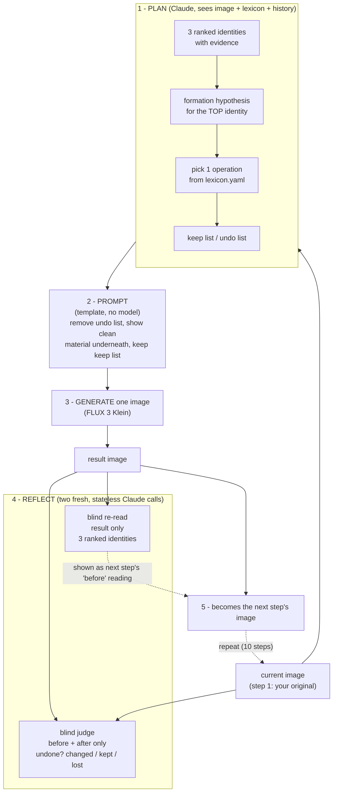
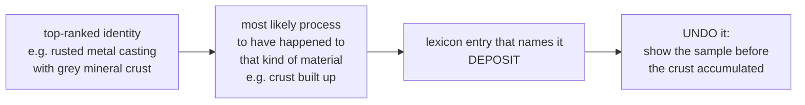
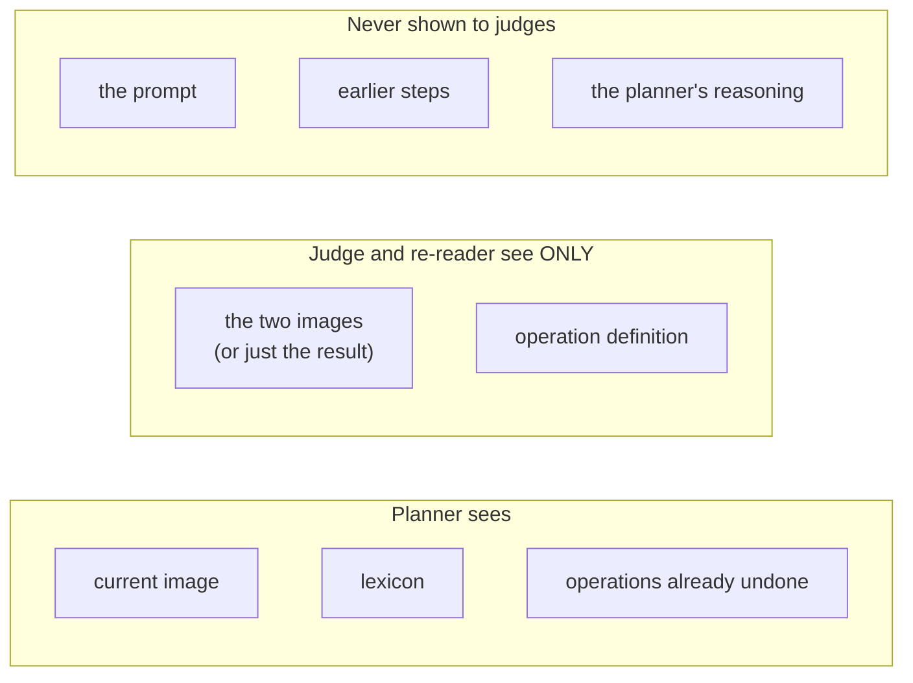

# How the system works

The loop walks a material sample **backwards in time**: read the image, infer what happened to the material, undo it, repeat.

## Who does what

| Actor | Model | Sees | Produces |
|---|---|---|---|
| **Planner** (reader) | Claude vision (`claude-sonnet-5-5`) | the current image, the lexicon, what was already undone | 3 ranked identities, formation hypothesis, one operation, keep/undo lists |
| **Image editor** | FLUX 3 Klein (BFL API) | the current image + the assembled prompt | one image: the sample *before* the operation |
| **Blind judge** | Claude vision, fresh call | before + after images, operation definition only | undone (clearly/partly/not visibly), changed, kept, lost |
| **Blind reader** | Claude vision, fresh call | the result image only | 3 ranked identities of the result |
| **Code** (no model) | Python | files | builds the prompt from a template, pixel-diff flag, writes `events.jsonl` |

**The identities come from the Planner (Claude).** There is no classifier or embedding model. The labels, their order and the evidence are the model's own judgment; their probabilities are kept in `record.json` but are not calibrated and are not shown in the UI.

## One step



## How the operation is picked



- The choice is restricted to the 18 operations in `lexicon.yaml` (three groups: formation, unmaking, reorganization).
- It picks the process that *happened*, then the loop undoes it. A crust that built up is DEPOSIT; the step removes the crust.
- Repeats are allowed. Earlier undone steps are shown to the planner only so it doesn't name products that are already gone.

## What stays blind



Every judgement starts from the same fixed system prompt, so no call inherits another's framing.

## What gets recorded

```
runs/<id>/
  run.json            config, lexicon, git commit, model names
  events.jsonl        every stage, followed live by the UI
  step_01/
    input.png         what the planner saw
    result.png        what Klein generated
    record.json       plan, prompt, seed, judge reflection, blind re-read, flags
```

## Known limits

- Nothing checks that the chosen operation is physically coherent beyond Claude's reasoning and the lexicon wording.
- Klein has no strength setting, so how much it undoes depends on prompt wording alone.
- The pixel diff is the only measured number; it only raises an "image barely changed" flag.
