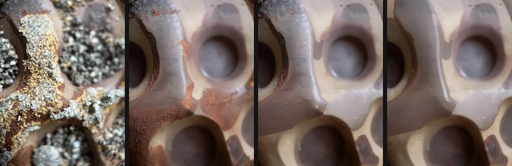
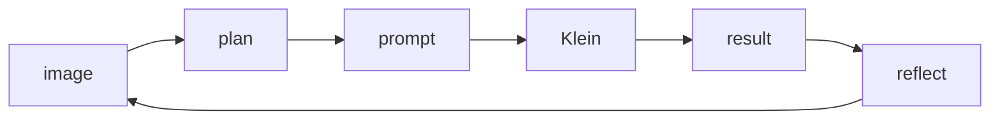
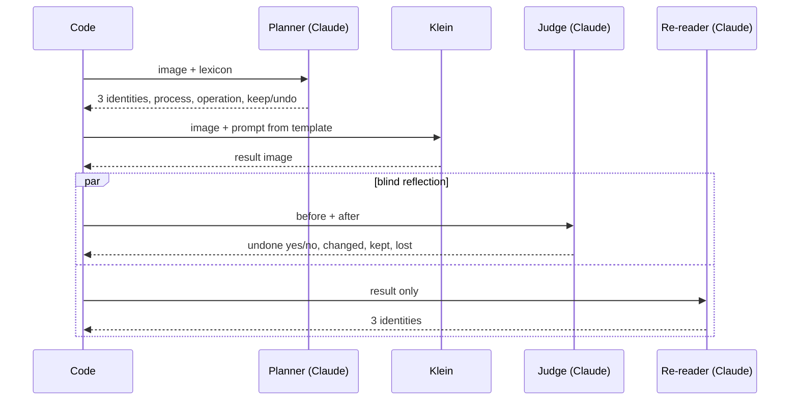
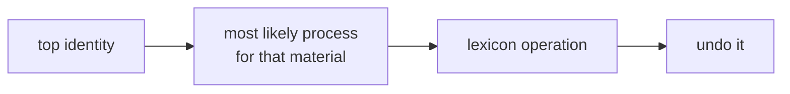
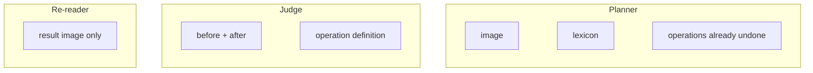
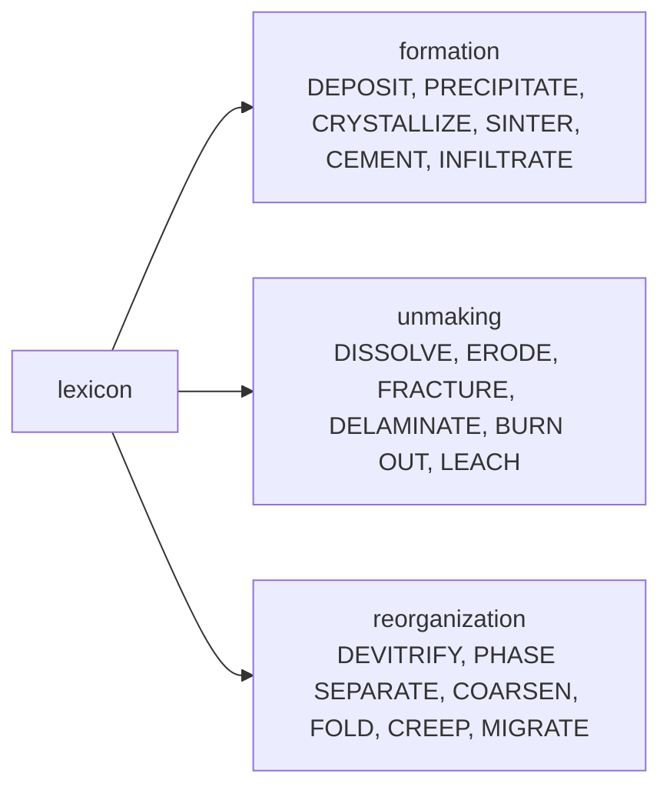
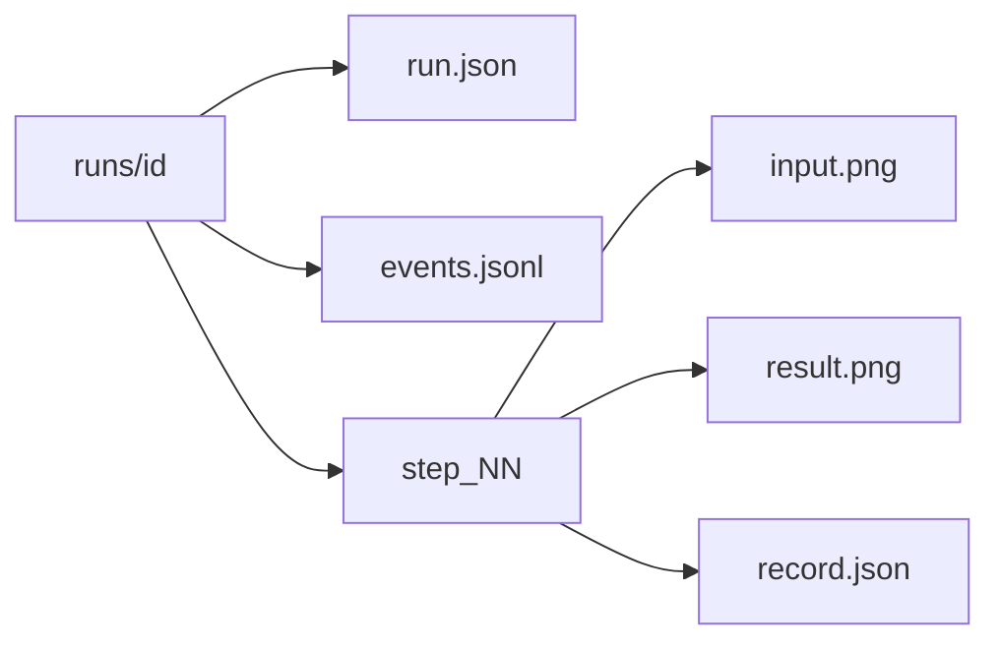

# Architecture

Walk a material sample **backwards in time**: read it, infer what happened to it, undo that, repeat.

## The loop

## One step

4 model roles, 0 persistent agents: every call is stateless.

## Picking the operation

## What each call sees

## Operation groups (`lexicon.yaml`)

## Run output

