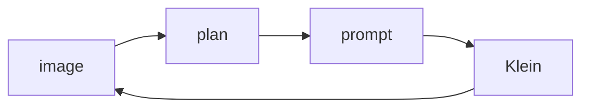
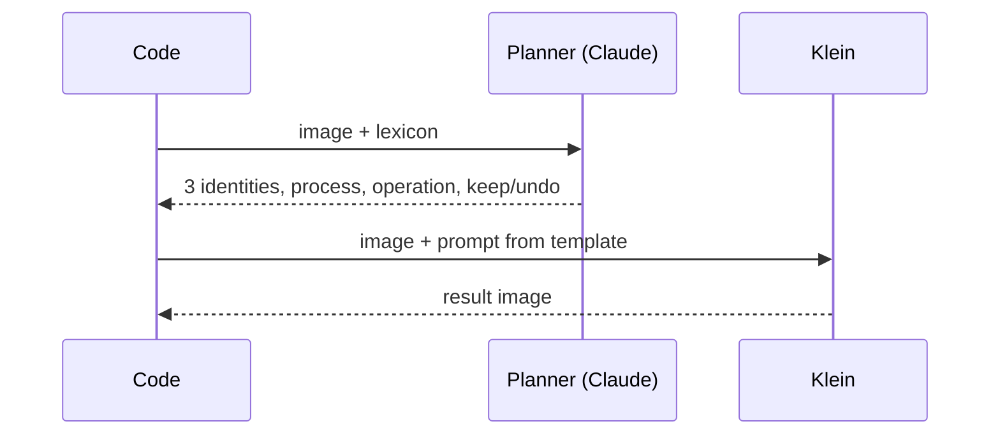
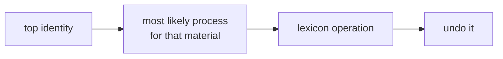
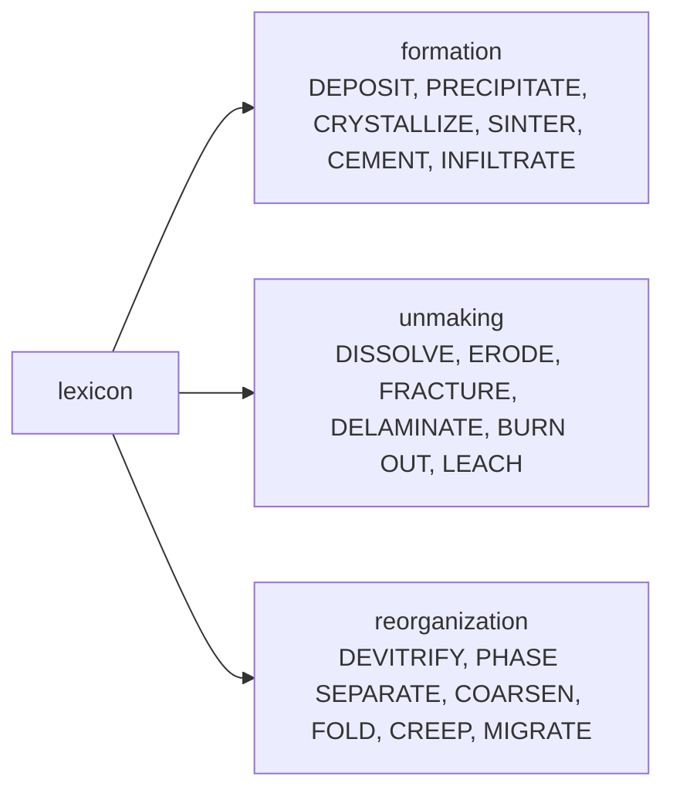
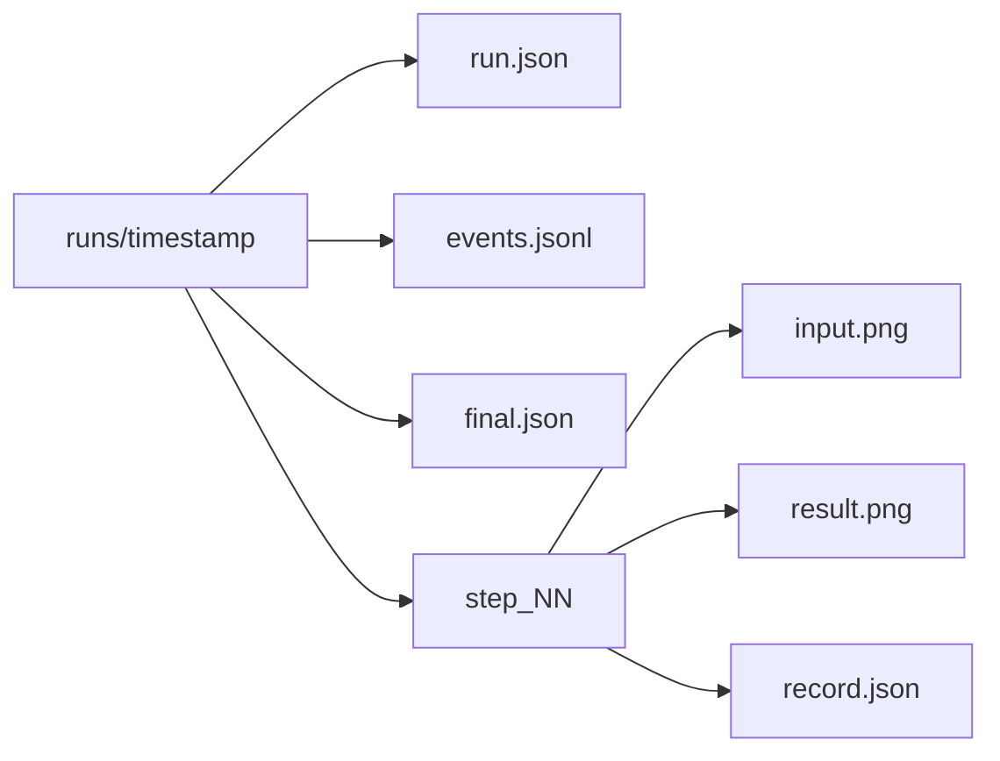

# Architecture

Walk a material sample **backwards in time**: read it, infer what happened to it, undo that, repeat.

## The loop

## One step

2 model roles, 0 persistent agents: every call is stateless. The planner sees only the current image and the lexicon, so every reading starts from the same point. One last read after the final step.

## Picking the operation

## Operation groups

## Run output

