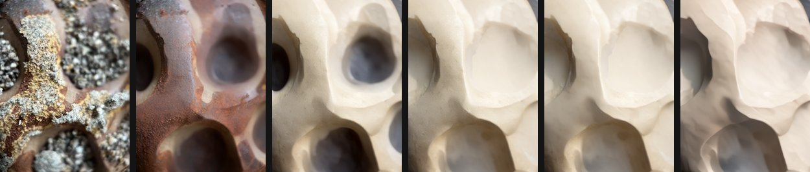
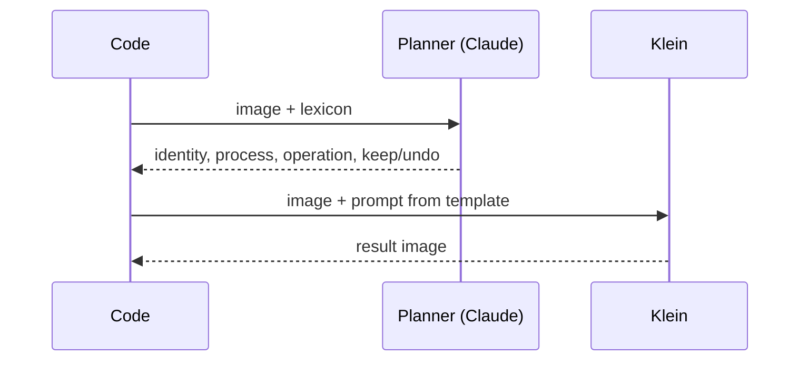
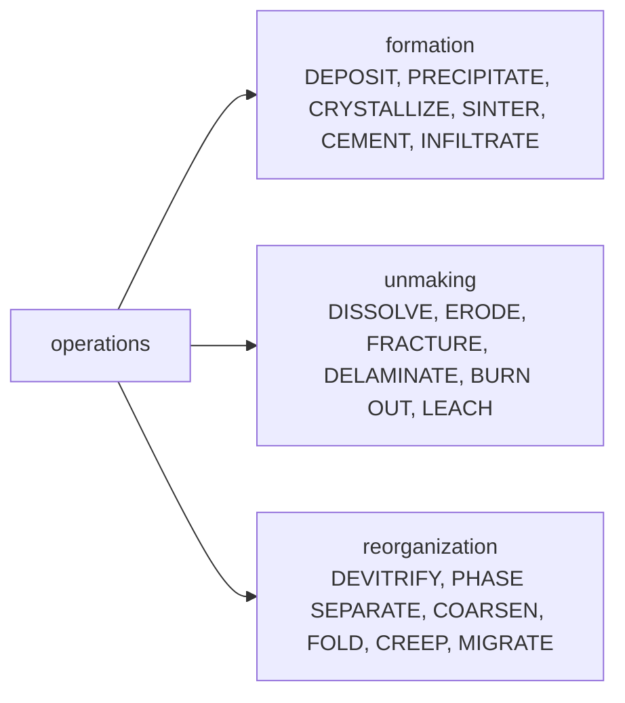

# Overview

Walk a material sample **backwards in time**: read it, infer what happened to it, undo that, repeat.
A model that just names a material flattens its histories; asking what happened to it keeps them open.



## Layers, peeled one at a time

```
photo         after step 1    after step 2    after step 3
~~~~ crust    ---- stain      ==== body       ?
---- stain    ==== body
==== body
```

## One step

```
image
  | what is it?          planner: one guess (any domain)
  v
"rusted cast iron"       the guess = the material
  | what happened to it? planner: one operation from the lexicon
  v
DEPOSIT
  | undo it
  v
Klein: show it BEFORE    -> new image -> next step
```



Every planner call is stateless: it sees only the current image and the lexicon. The image is all that carries over.

## What moves, what stays

```
stays    shape: ridges, cavities, framing      (inherits the past)
undone   surface: crust, stain, colour         (the operation)
shifts   what the model thinks it is           (the finding)
```

## Recognition drifts across domains

```
original  rusted metal casting, gray crust
step 3    gray-coated porous foam or ceramic
step 4    cream porous stone or plaster
step 6    skull-like plaster or bone cast
final     plaster-like sculpted porous solid
```

## Lexicon (`lexicon.yaml`)


